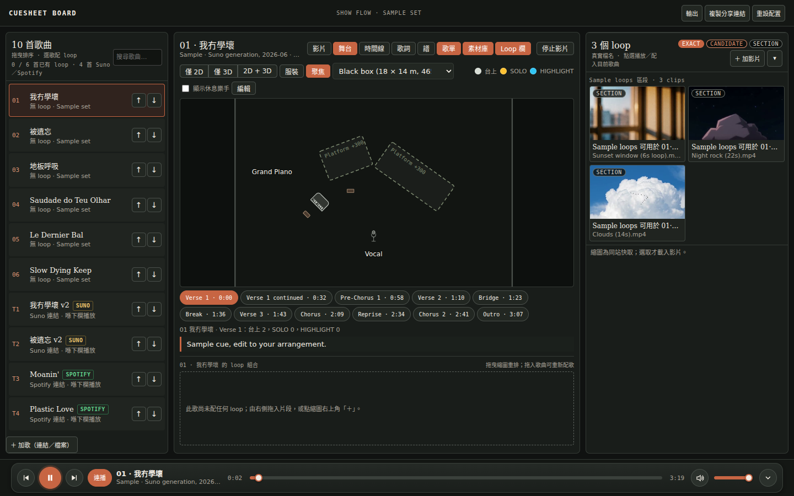
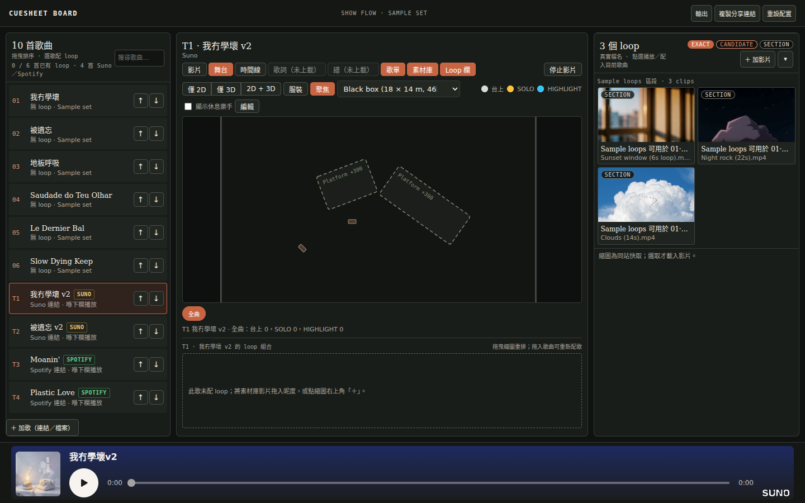

<p align="center"></p>

<p align="center"><strong>Who is on stage, who solos and how it is lit, song by song, tied to the rehearsal audio.</strong></p>

<p align="center">
  <a href="https://cuesheet-board-demo.netlify.app/">Live sample</a> ·
  <a href="#try-it">Run it</a> ·
  <a href="#use-your-own-set">Use your own set</a> ·
  <a href="CONTRIBUTING.md">Contribute</a> ·
  <a href="CHANGELOG.md">Changelog</a>
</p>

<p align="center">  </p>

A browser board for the part of a live set that usually lives in a Word file and a few WhatsApp messages: **who is on stage, who solos, and how it is lit, per song and per section**, tied to the rehearsal audio.

Open it, pick a song, press play. The 2D plan, the 3D lighting preview and the section timeline follow the audio. When the set is ready, tick what you need and export one report for the lighting operator.

> A [Mono Labs](https://github.com/meowhuman) tool. Built by a working music director for a real festival set, then cleaned up and published with a sample set so you can try it.



## Status

Early and honest:

- It was built for one real show. The engine is generic, the sample set in this repo is not that show.
- The interface text is **Traditional Chinese for now**. An English interface is the first item on the roadmap below.
- No server, no accounts. Everything runs in the browser; your edits, and the songs and videos you add, are kept in this browser only (`localStorage` and IndexedDB).
- The 3D venues are simple generated rooms (a black box with seats, a small club, a hall, an open stage). Loading a modelled venue from Blender is not built yet.

## What it does

- **Per-section staging.** Each song has sections (cues). Each cue says who is on stage, who is soloing, who is highlighted, plus a note for the crew.
- **2D plan and timeline.** Drag items on the plan, scrub the timeline, the playhead jumps between sections.
- **3D lighting preview.** Colour presets, custom colour and strength per light group, three spots that follow soloists, haze. Fixed camera presets, free orbit, audience seat view.
- **Rehearsal audio and video loops.** Several versions per song (for example instrumental and vocal), loops play in sync with the audio.
- **Add songs from the board.** `+ Add song` takes a Suno or Spotify link, or an audio file from your computer (mp3, wav, m4a, flac). Each row carries a small `SUNO`, `SPOTIFY` or `FILE` mark. Links play in a player inside the page; files play in the board's own player. Nothing is uploaded. See [Add songs and videos](#add-songs-and-videos).
- **Add videos from the board.** `+ Add video` puts your own clips in the loop library, where you can play them and assign them to songs.
- **Venue picker.** Each venue is a stage plan with its own stage size, room and light positions. Pick one in the stage bar or the 3D toolbar. See [Venues](#venues).
- **Lighting rig from a lighting designer.** Import an `.mvr` file (My Virtual Rig, exported by Capture, Vectorworks, grandMA3 and others) and the 3D preview uses their fixture positions. See [Import a lighting rig](#import-a-lighting-rig-mvr).
- **Hide the song list** with one button to give the middle column more room.
- **Lyrics and charts** per song, when you provide them.
- **One-click report.** Tick sections (order, matrix, 2D plan, 3D images, timeline, lighting settings, people), pick songs, get a single self-contained HTML file with no scripts and no external links. Print it to PDF from the browser.
- **Phone layout.** The board and the export dialog fit a phone screen.

## Try it

Live sample (unlisted, not indexed): https://cuesheet-board-demo.netlify.app/

Or run it yourself:

```bash
git clone https://github.com/meowhuman/cuesheet-board && cd cuesheet-board
python3 qa/range-server.py 8080 . 127.0.0.1
# open http://127.0.0.1:8080/
```

Any static server works, but it must support HTTP range requests, otherwise audio and video cannot seek. `qa/range-server.py` is a small one that does.

Open the board from `https://` or `localhost`. The Suno player refuses to play on a plain `http://` page with a network address (it needs a secure context), and the board shows a note when that happens.

## What the sample set shows

The sample set exercises every feature, so you can click through them before loading your own set.

| Feature | Where to look |
|---|---|
| Sections and timeline | Pick any song. Song 01 has 11 sections with a lyric-driven timeline |
| 2D plan, solo and highlight | Stage view. Grand Piano and Vocal are placed on the sample stage; the timeline colours show on-stage, solo and highlight |
| 3D lighting with an imported rig | Stage view, `僅 3D`, then the lighting button. 76 fixtures come from `samples/mvr/capture_demo_show.mvr` |
| Versions | Song 06 has instrumental and vocal audio versions |
| Suno and Spotify tracks | Rows T1 and T2 are Suno songs, T3 and T4 are Spotify tracks. Each has a small mark and plays inside the board. Try `+ Add song` at the bottom of the list |
| Venues | Stage view: the venue list next to `聚焦` (2D) or in the 3D toolbar: black box, jazz club, concert hall, open stage |
| Loops | Three sample video loops sit in the library on the right. Click one to play it, `+` assigns it to the current song, `+ Add video` adds your own |
| Lyrics and form chart | Song 01 has lyrics and a generated form chart |
| One-click report | `輸出`, tick sections, get a self-contained HTML file |
| Phone layout | Open it on a phone, or narrow the window to 390 px |

## Add songs and videos

Under the song list, `+ Add song` opens a small form. Give it one of:

- **A Suno or Spotify link.** Optionally a title. It becomes a row with a `SUNO` or `SPOTIFY` mark and plays in a compact player below the board.
- **An audio file.** mp3, wav, m4a or flac. It becomes a row with a `FILE` mark and plays in the board's own player.

The `x` button on a row you added removes it. Links, and songs and videos you add, live in this browser only. Clearing site data removes them.

In the loop library, `+ Add video` takes one or more video files. They appear under "My videos", with a thumbnail made from the first frame. Click to play, `+` to assign to the current song, `x` to remove.

For songs that should always be there, list them in `songs.json`:

```json
{ "number": "T1", "title": "My Suno song", "section": "Suno", "track": { "url": "https://suno.com/song/<uuid>" } }
```

- Only `https`, and only `suno.com` and `open.spotify.com` (song, album, playlist, episode), are accepted as links. Anything else is refused.
- The player is created when you pick the row and removed when you pick another song. Local audio pauses while a track plays.
- Tracks do not take part in auto-next, the timeline playhead or the exported report.
- Suno pages cannot be framed, so the board uses `suno.com/embed/<uuid>`. It needs a secure context: `https://` or `localhost`.
- Spotify plays a 30-second preview unless the browser is logged in to Spotify. Full tracks follow your Spotify account (Premium for full playback); the board never sees your login.
- Suno limits how many songs your account can download each month. Embedding a link does not use that allowance.
- A song can also carry a player as a version chip: add `{ "label": "suno", "embed": { "provider": "suno", "url": "..." } }` to its `alternates`.



## Venues

When `stage-plans.json` has more than one plan, the 3D toolbar shows a venue list. A plan has its own `stage` (size and screen), optional `room` (walls and optional seats) and optional `lighting` (a rig for that venue).

`tools/add-venues.py` builds the extra venues from the first plan by scaling the instruments, platforms and light positions:

```bash
python3 tools/add-venues.py            # preview: prints the venues, writes nothing
python3 tools/add-venues.py --apply    # writes stage-plans.json (a .bak copy is made first)
```

Venue sizes live in `tools/venues.default.json`. Run it after an MVR import so the lights it scales are the imported ones.

## Import a lighting rig (MVR)

Lighting designers can export their rig as an `.mvr` file. `tools/mvr-import.py` reads it and fills `lighting.rig.fixtures` in `stage-plans.json`:

```bash
# preview: prints a table and a summary, writes nothing
python3 tools/mvr-import.py samples/mvr/capture_demo_show.mvr
# write it (a .bak copy of stage-plans.json is made first)
python3 tools/mvr-import.py samples/mvr/capture_demo_show.mvr --apply
```

- Alignment and grouping live in `tools/mvr-map.default.json`: origin offset, rotation, flips, which fixture models go to the front, back or follow group, and default aim points. Edit that file, run the preview, and check how many fixtures land on the stage.
- Aim comes from the file's focus points when there are any; otherwise from the fixture's direction when it points at the floor; otherwise from the group default. The summary shows which source each fixture used. Check the 3D view after the first import.
- It reads only `GeneralSceneDescription.xml` from the zip, never extracts files, and rejects XML with a DOCTYPE.
- `samples/mvr/` holds three public test files (MIT, see `samples/mvr/LICENSE-python-mvr.txt`). `capture_demo_show.mvr` is a Capture export with 76 fixtures; the sample stage uses it.

## Use your own set

Everything is data files at the repo root. No build step.

| File | What it holds |
|---|---|
| `songs.json` | The song list. Per song: `number`, `title`, `section`, `credit`, `notes`, `parts`, `demo` (audio path), `demoLabel`, `alternates` (`[{label, src}]` for audio, or `[{label, embed:{provider, url}}]` for a Suno or Spotify player), optional `bpm`, `lyrics` (`{lang: text}`), `charts` (`{key: path}`) |
| `stage-cues.json` | Default cues per song: `{ "cues": { "01": [{ "name", "at", "on", "solo", "hl", "note" }] } }`. `at` is seconds into the audio; `on`, `solo`, `hl` are item ids from the stage plan |
| `stage-plans.json` | The stage plan (items and positions), `partItems` (which instrument codes light up which items), lighting presets and rig, export defaults, page title, header links |
| `source-materials/drive-video-inventory.json` | The video loop list. Files live in `media/loops/<fileId>.mp4`, thumbnails in `source-materials/thumbnails/<fileId>.jpg` |

`tools/make-demo-data.py` shows one way to generate these files from audio: it detects sections from loudness changes (or reads lyric section tags) and writes sample cues and a form chart per song. The sample cues it produces are placeholders. Edit them to your arrangement in the board; changes are saved in your browser, and the stage panel's Export button saves them as JSON so you can put them back into `stage-cues.json`.

## Tests

```bash
npm install
npm run serve &        # range-capable static server on :9424
npm test               # Playwright smoke test and the add-songs/videos test
```

`qa/files.mjs` checks adding an audio file and a video from the board, that they survive a reload and can be removed, and that the middle column has no scroll bars. The smoke test checks: no external network requests, audio and video load, lyrics, charts and timeline render, the 3D view mounts with the imported rig and the lighting presets light fixtures, Suno and Spotify rows play in a player that appears and is removed again, pasting a link adds a row (the iframe target is faked, so no network is used), the venue list changes the stage and the light positions, the song-list button works, the report exports as a self-contained file, the phone layout does not overflow, and the repository contains no leftover private strings.

## Roadmap

1. English interface (all strings are currently Traditional Chinese).
2. Venue size and seating from `stage-plans.json` instead of a fixed room.
3. One `show.json` instead of four data files.
4. Import lighting cues (colour and level per fixture or group, per song) from a CSV. Fixture positions already import from MVR.
5. Load saved Blender venues (modelled rooms) instead of the generated ones.

See [CONTRIBUTING.md](CONTRIBUTING.md) before opening a pull request. If you run a rehearsal or a show with it, I would like to hear what broke: open an issue.

## Credits and prior art

- [three.js](https://threejs.org) renders the 3D view.
- `samples/mvr/` test files come from [open-stage/python-mvr](https://github.com/open-stage/python-mvr) (MIT).
- Instrument models were generated with TRELLIS.2 and normalised in Blender.
- Free tools that overlap in part: Limelight (3D lighting and cue paperwork), TecRider and Stageplot Pro (stage plots and input lists), BandHelper (setlists and scheduling). cuesheet-board is aimed at the gap between them: the song-by-song staging and lighting of a whole set, with the audio.

## Licence and name

- **Code: MIT**, see [LICENSE](LICENSE). You may use, change and sell it, and you must keep the copyright notice.
- **Sample media** has separate terms, see [NOTICE](NOTICE).
- **Name and logo are not licensed.** "cuesheet-board", "Mono Labs" and the logo are the author's marks. A fork or a product built on this code needs its own name and logo, and must not suggest it is the original or endorsed by it. See [TRADEMARKS.md](TRADEMARKS.md).
